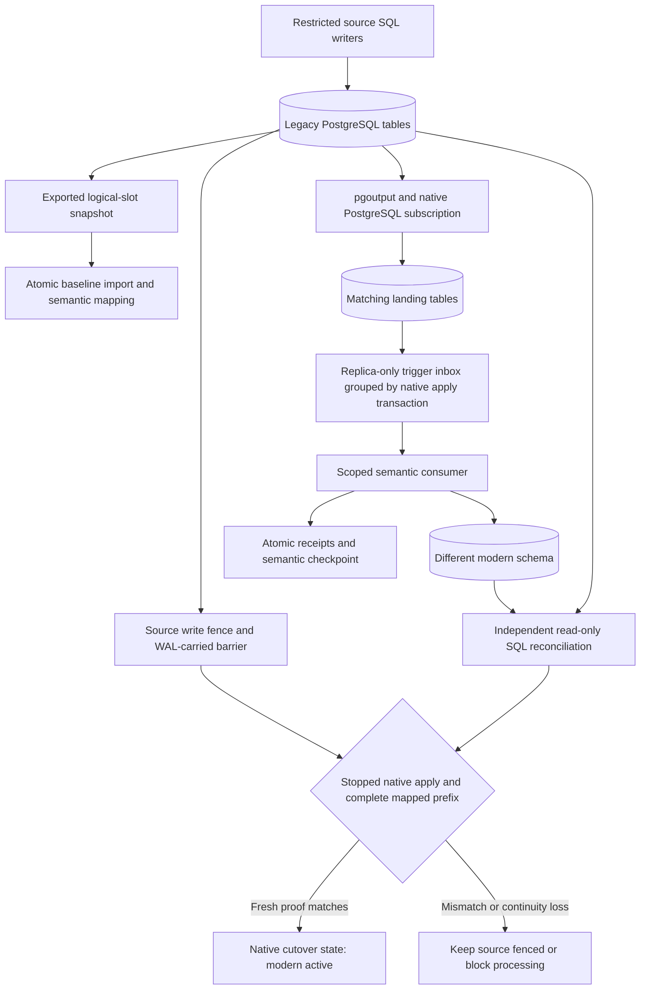

# Native PostgreSQL CDC and migration recovery

A migration can copy every row and still lose concurrent updates, split a transaction or erase the distinction between unknown and false. This optional lane uses actual PostgreSQL 17 logical replication and then applies the existing lossless mapping contract to a different destination schema. It complements the original SQLite cutover and reverse-mapping implementation.

[Recorded native run](evidence/postgres-cdc/report.md) · [Raw cases and source seal](evidence/postgres-cdc/native/protocol.json) · [Software tests](evidence/postgres-cdc/software/verification.json) · [Preserved baseline](evidence/postgres-cdc/baseline/verification.json).



## Where native replication ends

There is no source-side application change log. Ordinary SQL writes to `legacy.organizations` and `legacy.people` produce PostgreSQL WAL. The built-in `pgoutput` publication/subscription transports those changes into matching landing tables in the destination database. This is the native replication boundary.

The subscriber's replica-only triggers append row changes into an inbox **inside the same native apply transaction**. They require an established replication origin. Their transaction key is the subscriber's extended `xid8`, not a fabricated source transaction ID. PostgreSQL applies each source commit atomically; the separate mapper consumes one complete committed inbox group at a time. Identical-table replication is therefore only staging: the final business data is in `modern.companies` and `modern.contacts`, with different names, lifecycle codes, JSON channel sets and three-valued subscription representation.

No Kafka, Debezium, custom pgoutput decoder or source-maintained event stream is used. Psycopg's replication connection is used only to issue the standard slot/snapshot command; PostgreSQL handles the stream protocol, feedback and native apply.

## One snapshot, one stream boundary

The publication exists before `CREATE_REPLICATION_SLOT ... LOGICAL pgoutput EXPORT_SNAPSHOT`. A repeatable-read source transaction imports that exact exported snapshot while its exporting connection remains open. Keyset pages across all source tables share that snapshot. The baseline is loaded into landing and modern tables with the snapshot seal in one target transaction. Only then is the subscription created with the existing slot, `create_slot=false` and `copy_data=false`.

This avoids independent per-table initial-copy snapshots and establishes an explicit snapshot/stream boundary. Writes during slot acquisition and transfer are tested with real source transactions. If bootstrap is interrupted before completion, the controller does not invent a usable old snapshot or reuse a slot blindly: clean up the disposable run and take a new snapshot.

## Two durable positions, not one misleading cursor

1. **Native capture progress:** PostgreSQL's replication origin tracks the publisher LSN durably applied to landing tables and the inbox. `synchronous_commit=on` is enforced for native apply. The mapper records a monotonic observed native-origin floor with its receipt transaction.
2. **Semantic progress:** the inbox sequence, transaction receipt and hash chain identify the complete prefix transformed into the modern schema. Data, receipt, cursor, chain and native floor commit together. A native origin ahead of this semantic cursor means data is staged, not necessarily transformed. It is never permission to skip inbox groups.

The inbox is append-only and is not pruned in this bounded lane. Sequence gaps caused by rolled-back transactions are allowed; complete groups and receipts, not a false assumption of contiguous sequence allocation, establish coverage. Schema versions 1 and 2 reuse the original mapping contracts. Unknown subscription remains distinct from false; stable IDs, parent-child keys, lifecycle, locale and channel sets remain inspectable.

Slot `restart_lsn` concerns retention, and `confirmed_flush_lsn` concerns native acknowledgment. Neither is blindly equated to a per-publication commit boundary. The recorded byte-lag/retention observations use cluster-wide WAL positions; the local source and destination are separate databases in one server, so those byte counts include WAL unrelated to the business publication. They are not end-to-end business lag or a production throughput benchmark.

## Failure handling and cutover

A real consumer process is paused and killed before target commit, and separately after commit but before application acknowledgment. Independent read-only connections observe the reopened state; a replacement process and exact redelivery establish replay behavior. A source replication connection is terminated while its temporary replication identity cannot log in. WAL remains retained, processing blocks, and the controller verifies continuity before re-enabling the existing subscription. This is explicit supported recovery, not a claim of unattended reconnect policy.

The health checks pin source identity, schemas, publication, subscription and supported native apply settings. They reject missing/invalidated slots, lost/regressed native-origin state, unusable receipt/checkpoint chains, unsupported mapping versions and schema drift. Streaming/parallel apply and two-phase replication are disabled; table-sync membership must remain the three ready landing relations. Incompatible DDL is not replicated automatically and is tested to stop native apply without advancing the semantic checkpoint.

Supported source writes take a database row-share lock on the source gate. Freezing obtains the conflicting lock, drains in-flight writers and commits a durable fence plus a WAL-carried barrier. Barrier rows are control markers, not the business CDC feed. After that exact barrier arrives, native apply is disabled, the mapper drains all captured groups, and independent SQL compares business meaning. Cutover requires the matched barrier/source transaction, exact stopped native-origin position, complete mapped prefix, current implementation and fresh semantic proof. Changing target meaning invalidates an otherwise passing report. The source remains fenced when the native cutover state becomes `modern_active`.

The native lane demonstrates the fence and activation decision, not an external application traffic switch. Its reverse PostgreSQL migration is not implemented; the existing SQLite reverse mapping and rollback tests remain unchanged.

## Supported authority boundary

Temporary source writer, source observer, replication and target mapper identities are separate. The consumer configuration contains only read-only source and scoped target credentials. It cannot change source data, create/drop slots, write landing tables or set the target route. Independent observers have read-only access. The local bootstrap/replication owner remains trusted; it is not a production administrator-hardening demonstration.

The controller never recreates a missing slot or resets an origin/checkpoint to make a run pass. Privileged same-name slot replacement, manual slot advancement, physical target restore and uncoordinated administrator changes are outside the supported continuity contract. Such intervention requires a separately validated recovery plan or fresh snapshot. This lane does not establish exactly-once delivery under arbitrary infrastructure/admin failures, PostgreSQL HA, power-loss recovery, long-retention scale, automatic DDL upgrades or zero downtime.

## Reproduce locally

The original SQLite core still needs only Python's standard library at runtime. The native lane additionally needs the optional pinned driver and an explicitly isolated PostgreSQL **17** server configured for logical replication. No vendor account, private business credentials or paid service is needed.

With Docker, from a full Git checkout, set the source revision and use a fresh output directory:

```powershell
$env:MIGRATION_SOURCE_COMMIT = git rev-parse HEAD
docker compose -f compose.postgres.yml run --build --rm verify
docker compose -f compose.postgres.yml down --volumes
```

The Compose database has no published ports and runs on an internal network. Its native roles use per-run random credentials kept in the ignored application workspace. The test database bootstrap is intentionally isolated; do not aim this command at an operator or customer database. The container runs the installed wheel, complete software suite and actual native acceptance, then exports sanitized proof under `work/container-proof/run`. Remove that directory or choose a fresh checkout before repeating; observed results are never overwritten.

For an already isolated local server:

```text
python -m pip install -r requirements-postgres.lock
python -m pip install --no-deps --no-build-isolation -e .
# Set MIGRATION_PG_ADMIN_DSN privately to the local disposable PostgreSQL server.
python scripts/verify_native.py --workspace work/new-native-private --output work/new-native-proof
```

Set `wal_level=logical`, `max_replication_slots=10`, `max_wal_senders=10`, `max_slot_wal_keep_size=256MB`, and keep durable commit/fsync enabled. Local accepted endpoints are loopback and the Compose `postgres` service. A run owns only its nonce-named databases, slot and roles. Cleanup drops the subscription and origin, releases retained WAL by dropping the exact slot, drops the two disposable databases/publication and roles, then checks absence through a separate catalog connection. The WAL-retention setting is not a hard disk-space cap; the bounded synthetic fixture and explicit teardown are part of this acceptance contract.

To inspect the published proof without PostgreSQL or the optional driver:

```text
python scripts/check_postgres.py docs/evidence/postgres-cdc/native --source-root .
python scripts/validate_native_repo.py
```

The first command checks artifacts, source fingerprints, raw semantic projections, transaction groups, receipt chains, replay/failure records and cleanup. The second requires full Git history/file inventory to check package/public-content boundaries. Original SQLite evidence remains pinned to its historical revision, not relabeled as new native execution.

## PostgreSQL contracts used

- [Replication protocol and exported snapshot lifetime](https://www.postgresql.org/docs/17/protocol-replication.html)
- [Subscription parameters and same-cluster pre-created-slot requirement](https://www.postgresql.org/docs/17/sql-createsubscription.html)
- [Native apply architecture and replica triggers](https://www.postgresql.org/docs/17/logical-replication-architecture.html)
- [Schema/DDL and logical-replication restrictions](https://www.postgresql.org/docs/17/logical-replication-restrictions.html)
- [Slot retention settings](https://www.postgresql.org/docs/17/runtime-config-replication.html)
